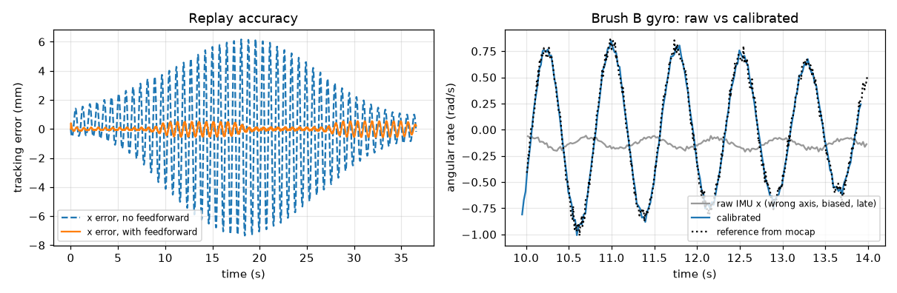

# Robot-assisted IMU validation bench (simulation)

A simulated test bench that replays human brushing motion on a 6-DOF robot arm, measures it with a motion-capture system, and separates **true motion differences** from **sensor effects** in the IMUs of different toothbrushes: axis conventions, mounting misalignment, offset, scale, noise, filtering and timing.

Everything runs in Python on Linux with MuJoCo, using the Universal Robots UR5e model from MuJoCo Menagerie. The method applies to any 6-DOF arm.



Video of the replay (arm, drawn brush, brush-head trail and close-up, live raw vs calibrated gyro): [results/bench_demo.mp4](results/bench_demo.mp4)

## Pipeline

```
human brushing poses (120 Hz, position + quaternion)
   └─► continuous, limit-checked joint trajectory (TCP = brush head, collision-checked IK, time scaling)
        └─► replay on the arm's position servos (+ gravity and velocity feedforward)
             ├─► "OptiTrack": noisy marker poses in its own frame ─► robot/mocap calibration
             └─► "IMU" in each brush: axis swap, misalignment, bias, scale, noise, low-pass, delay, own rate
                  └─► protocol-based calibration ─► validation on brushing ─► cross-brush comparison
```

| File | What it does |
|---|---|
| `bench.py` | Motions, IK and trajectory planning, replay, motion capture and IMU models, calibration |
| `run_all.py` | Runs everything and writes `results/results.md` and the figure |
| `render_video.py` | Renders the replay video |

## Results (full numbers in [results/results.md](results/results.md))

**Trajectory and replay**
- IK residual on the brushing trajectory: under 0.001 mm and 0.0001 deg. **Collision checked** against the floor and the robot itself.
- **Real brushing is too fast for the arm:** 4 Hz strokes exceed the joint acceleration limits, so the whole trajectory is **slowed down 3.05x** (time scaling keeps the path identical). A test protocol has to account for this, since the IMU then sees slower motion than in a real mouth.
- Replay accuracy: **9.65 mm RMS** with plain position servos, **0.28 mm and 0.07 deg RMS** with gravity and velocity feedforward. Repeatability over 5 disturbed replays: 0.016 mm.

**Robot to motion-capture calibration** (25 poses, frame pose and marker offset solved jointly)
- Frame: 0.018 deg and 0.42 mm error. Marker offset: 0.09 mm error.

**IMU calibration on the protocol** (two brushes with different mountings, biases, scales, filters, delays and sample rates)

| | Brush A true | Brush A estimated | Brush B true | Brush B estimated |
|---|---|---|---|---|
| Axis convention | | correct | | correct |
| Mount misalignment (deg) | 2.70 | 2.70 | 3.37 | 3.32 |
| Gyro scale | 1.03, 0.98, 1.01 | 1.029, 0.978, 1.010 | 0.97, 1.04, 1.00 | 0.970, 1.040, 0.999 |
| Gyro bias (rad/s) | 0.020, -0.015, 0.010 | 0.020, -0.015, 0.010 | -0.030, 0.020, 0.000 | -0.030, 0.020, 0.000 |
| Accel bias (m/s2) | 0.15, -0.10, 0.20 | 0.146, -0.103, 0.197 | 0.15, -0.10, 0.20 | 0.155, -0.102, 0.201 |
| Gyro noise (rad/s) | 0.010 | 0.010 | 0.010 | 0.010 |

**Validation on brushing, which was not used for calibration:** before calibration the two brushes are *negatively* correlated (-0.49, -0.02, -0.31). After calibration the correlation is **0.998, 0.998, 0.951** and the RMS difference drops from 0.71 to 0.034 rad/s.

## What I learned (and what I would change on the real bench)

1. **Calibrating on brushing alone fails.** My first version estimated one gyro axis scale as 0.32 instead of 1.01, because brushing hardly rotates the brush about that axis, so it was not identifiable. This is exactly why the protocol needs dedicated roll/pitch/yaw tests, and static +-X/Y/Z poses where gravity gives +-1 g on every accelerometer axis.
2. **Differentiating motion capture amplifies its noise.** Noise estimates were 4x too high until the reference was smoothed (Savitzky-Golay) and the IMU noise was measured on the static segments instead.
3. **Inverse kinematics can pick a configuration through the floor.** One protocol pose made the simulated arm hit the floor and move 56 mm while it should hold still. Collision checking is now part of the planner, and the protocol runs 15 cm higher than the brushing workspace so flipped poses clear the floor.
4. **Delay and filter lag are confounded.** A transport delay and a low-pass filter both shift the signal, and at the speeds the arm allows they cannot be cleanly separated (the total lag is within about 10 to 20 ms). On a real bench I would add a sharp tap or impact test for a clean timing edge.

## Limitations

- Simulation only: the arm is a UR5e model, not the reBot B601. Motion capture and IMU are statistical models, not real sensors.
- The synthetic brushing motion is a parametric approximation of real brushing.
- No ROS 2 integration yet. On the real bench the planner output would be sent as a `JointTrajectory`.

## Run

```bash
pip install mujoco numpy scipy matplotlib
git clone --depth 1 --filter=blob:none --sparse https://github.com/google-deepmind/mujoco_menagerie.git
(cd mujoco_menagerie && git sparse-checkout set universal_robots_ur5e)
python run_all.py      # about 1 minute on a laptop CPU
```

**Author:** Saadna Ilyes, final-year Industrial Networks & AI engineering student · [GitHub](https://github.com/ilyessaadna10) · [LinkedIn](https://linkedin.com/in/ilyes-saadna) · ilyessaadna4@gmail.com
